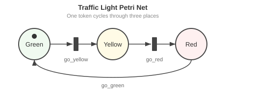
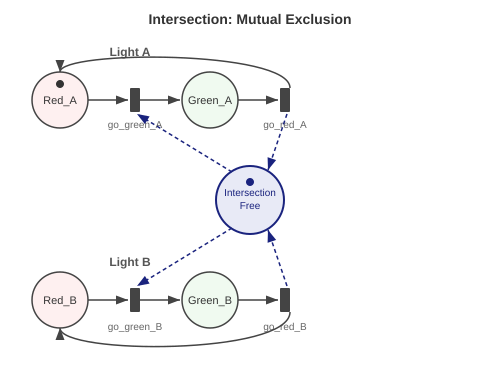

# Why Petri Nets?

**Learning objective**: Understand what Petri nets offer over flowcharts, state machines, and ad-hoc modeling.

You already know how to model systems. You've drawn flowcharts on whiteboards, sketched state machines in design docs, and built ad-hoc abstractions in code. These tools work for small systems. This chapter is about where they break, and what Petri nets offer instead.

## The Problem with Informal Models

Every software project starts with a model, whether the team knows it or not. Someone draws boxes and arrows on a whiteboard. Someone else writes a state machine in an enum. A third person embeds the workflow directly in if-else chains. All three believe they're describing the same system.

They usually aren't.

Informal models fail in predictable ways:

**Flowcharts can't express concurrency.** A flowchart is a sequence with branches. It handles "do A then B" and "do A or B" well enough. But "do A and B at the same time, then wait for both to finish" requires awkward workarounds — swim lanes, join bars, footnotes — and real systems are concurrent.

**State machines explode.** A state machine with $n$ boolean variables has $2^n$ possible states. A system tracking 10 independent conditions has 1,024 states. Most of those states are meaningless combinations, but the machine doesn't know that. You end up either enumerating impossible states or pretending they can't happen.

**Ad-hoc models can't be analyzed.** When the workflow lives in code — scattered across handlers, middleware, and database triggers — there's no way to ask "can this system deadlock?" or "is this queue bounded?" You find out in production, at 3am.

The root problem is the same in each case: the model doesn't capture the structure of the system it represents. Concurrency, resources and state are left implicit, and you can't analyze what you haven't modeled.

## A Brief History

In 1962, Carl Adam Petri submitted his doctoral dissertation, *Kommunikation mit Automaten* (Communication with Automata), to the Technical University of Darmstadt. He was 36 years old, and he had been thinking about the problem for over a decade — his first sketches of what would become Petri nets date to 1939, when he was thirteen.

Petri's insight was simple to state: concurrent systems need a model where multiple things can be true at the same time. State machines force you to enumerate every combination of conditions as a single global state. Petri's nets decompose the state into independent pieces — *places* — each holding its own local truth. The interactions between these pieces are explicit in the structure of the net.

The formalism found its first serious applications in hardware design, where concurrency is unavoidable. By the 1980s they were in wide use for manufacturing systems and communication protocols, and workflow modeling took them up in the 1990s. Business process notations such as BPMN describe their execution in terms of tokens moving through a diagram, and a common way to analyze such a diagram formally is to translate it into a Petri net, even though most practitioners never see that net.

Petri spent his career at the GMD (German National Research Centre for Computer Science) in Bonn, refining the theory and advocating for precise models of concurrent systems. He died in 2010. The formalism he created — places, transitions, and the flow of tokens between them — is still the base that colored, timed and stochastic Petri nets extend, and it is the base this book builds on.

## Places, Transitions, Arcs, Tokens

A Petri net has exactly four kinds of things:

**Places** are drawn as circles. A place represents a condition that can be true or false, a resource that can be available or consumed, a state that a piece of the system can be in. Think of a place as a container.

**Tokens** are drawn as dots inside places. Tokens represent the *current state* of the system: which conditions hold, how many resources are available, where entities are in a process. The distribution of tokens across all places is called the **marking** — it's the complete snapshot of the system at a moment in time.

**Transitions** are drawn as rectangles (or bars). A transition represents an event, an action, something that *happens*, such as registering a user or brewing a coffee. A transition changes the state of the system by moving tokens around.

**Arcs** are arrows connecting places to transitions and transitions to places. An arc from a place to a transition means "this transition needs a token from this place." An arc from a transition to a place means "this transition produces a token in this place." Arcs define the flow — who needs what, and who produces what.

That is the whole vocabulary of an ordinary Petri net. A traffic light, a biochemical pathway and a poker game are all built from these four elements.

One distinction is worth fixing now, because the rest of the book leans on it. Places, transitions and arcs are **structure** — they are what a model *is*. Tokens are **state** — the marking is what a model is *doing* right now, and it changes on every firing while the structure does not. The alphabet this book builds with is therefore three structural terms plus one more that arrives in Chapter 4: the **guard**, a condition on when a transition may fire. Place, transition, arc, guard — four primitives, and no fifth. Everything else, from `balances` to `brew` to the tic-tac-toe move `X00`, is what a domain sounds like once it has been written in them. The guard is not on the same footing as the other three, though. The incidence matrix of Chapter 2 records places, transitions and arcs; a guard is a predicate on the marking that the matrix does not see, so a property that depends on a guard is checked by exploring states rather than by linear algebra. [Appendix E](appendix-e-categorical-foundations.md#where-the-free-structure-stops-two-boundaries) states exactly where that line falls.

### The Firing Rule

The one rule that makes the whole thing work:

> A transition **fires** when every input place has at least one token. When it fires, it removes one token from each input place and adds one token to each output place.

This single rule gives you sequencing (token moves from A to B), concurrency (two transitions can fire independently if they don't share input places), synchronization (a transition with two input places waits for both), and resource management (a place with $n$ tokens represents $n$ available resources).

### Weighted Arcs

Sometimes a transition needs more than one token from a place, or produces more than one. A number on an arc — its **weight** — specifies how many tokens are consumed or produced. An arc with weight 3 from a place to a transition means "this transition needs 3 tokens from this place to fire." The firing rule generalizes accordingly: a transition is enabled when each input place holds at least its arc's weight, and firing removes that many tokens and adds each output arc's weight to its place. The rule above is the case where every weight is 1; Chapter 2 gives the formal version.

## Your First Net: A Traffic Stoplight

A traffic light cycles through three states: green, yellow, red. At any moment, exactly one light is on. Here's the Petri net:

```
    *
   [Green]--> [go_yellow] --> [Yellow]--> [go_red] --> [Red]--> [go_green]
      ^                                                              |
      +--------------------------------------------------------------+
```



Three places: `Green`, `Yellow`, `Red`. Three transitions: `go_yellow`, `go_red`, `go_green`. One token, starting in `Green`.

The token's position tells you which light is on. Fire `go_yellow` and the token moves from `Green` to `Yellow`. Fire `go_red` and it moves from `Yellow` to `Red`. Fire `go_green` and it cycles back to `Green`.

The same net is in go-pflow as [`examples/stoplight/petri_net.go`](https://github.com/pflow-xyz/go-pflow/blob/main/examples/stoplight/petri_net.go), with the token starting in `Red` and the transitions named `RedToGreen`, `GreenToYellow` and `YellowToRed`; its test checks the shape — three places, three transitions, six arcs ([`petri_net_test.go`](https://github.com/pflow-xyz/go-pflow/blob/main/examples/stoplight/petri_net_test.go)).

This is almost trivially simple — a state machine would work just as well. But notice what the Petri net gives you for free:

**Conservation.** Each transition takes one token from one place and puts one token into the next, so no firing changes the sum $M(\text{Green}) + M(\text{Yellow}) + M(\text{Red})$. It starts at 1 and stays at 1: exactly one light is on in every reachable marking. That follows from the arcs alone, with no runtime check. Chapter 2 restates the argument in matrix form, as a P-invariant $w$ with $w^T C = 0$ and $w = [1, 1, 1]$.

**Impossible states are unreachable.** A hand-written state machine for this light keeps the color in a variable, and a bug can set it to something outside the three valid values. In the net you can write down a marking with tokens in both `Green` and `Red`, but its token sum is 2, so the conservation law rules it out of every run that starts from the initial marking. The bad state is excluded by a property you can check rather than by a convention you have to keep.

**Composability.** Want to model an intersection? Add a second traffic light net. Connect them with a coordination mechanism — a shared place that ensures one direction is red when the other is green. Each light keeps its internal structure; the coordination is explicit in the arcs between them.

### An Intersection

Two lights need to coordinate. To keep the example small, each light here has only red and green. We add a shared place `Intersection_Free` that acts as a mutual exclusion lock. Written as each transition's inputs and outputs:

```
go_green_A:  Red_A + Intersection_Free  -->  Green_A
go_red_A:    Green_A                    -->  Red_A + Intersection_Free
go_green_B:  Red_B + Intersection_Free  -->  Green_B
go_red_B:    Green_B                    -->  Red_B + Intersection_Free

initial marking:  Red_A = 1, Red_B = 1, Intersection_Free = 1
```



The token in `Intersection_Free` is consumed when one light turns green and returned when it turns red. Every transition moves that one token between `Intersection_Free` and a `Green` place, so the token count of `Intersection_Free`, `Green_A` and `Green_B` together stays at its initial value of 1, and the two lights are never green together. As with the single light, this is derived from the arcs by hand. The same net, with `idle`/`busy` in place of `Red`/`Green` and `sem` in place of `Intersection_Free`, is the `mutexNet` fixture in go-pflow's [`verify/verify_test.go`](https://github.com/pflow-xyz/go-pflow/blob/main/verify/verify_test.go): `TestMutualExclusionProvedStructurally` requires the verifier to prove "at most one of `busy1`, `busy2`" from the semaphore invariant rather than by enumerating states, and `TestMutualExclusionRefutedWithCounterexample` removes the semaphore arcs from one client and requires a replayable firing sequence that makes both busy (the tests are cited, not re-run for this chapter).

This pattern — a shared resource place controlling access — models mutexes, semaphores, limited capacity, and turn-taking. It returns as turn control in [Chapter 6: Game Mechanics — Tic-Tac-Toe](ch06-game-mechanics.md).

## Small Models, Not Large Language Models

Say "model" in a meeting today and most people hear "large language model": billions of parameters, opaque weights, probabilistic outputs. Petri nets are a different kind of model, small and executable, and inspectable all the way down.

A coffee shop with five ingredients and five recipes is ten places and five transitions ([Chapter 5](ch05-resource-modeling.md)). petri-pilot's Texas Hold'em model, a simplified five-player table with all four betting rounds, has 18 places and 32 transitions ([`services/texas-holdem.json`](https://github.com/pflow-xyz/petri-pilot/blob/main/services/texas-holdem.json)). A Sudoku solver is larger but still finite and fully visible.

Small models offer properties that large models cannot:

| Property | Large Language Models | Petri Nets |
|----------|---------------------|------------|
| Inspectable | No | Yes — read the topology |
| Composable | Awkward | Native — connect shared places |
| Provable properties | No | Yes — invariants from the structure; reachability and deadlock by exploring states |
| Executable | Via code generation | Directly — tokens flow |
| Deterministic | Not in general | Yes, given the same firing sequence |

A Petri net model lets you answer questions before writing implementation code:

**Reachability**: "Given this initial state, can the system reach that target state?" This tells you whether a workflow is completable, whether a game has a winning move, whether an order can be fulfilled from current inventory.

**Boundedness**: "Does the system stay within limits?" This tells you whether a queue can overflow, whether a resource pool is properly managed, whether your system is closed or leaking.

**Deadlock and liveness**: "Can the system get stuck?" Deadlock-freedom means no reachable marking leaves every transition disabled. Liveness is stronger: every transition can always fire again, from every reachable marking. go-pflow's `pflow verify` checks `deadlock-free` directly, and its `live` property is the weaker check that every transition fires from some reachable marking; the code's own comment warns that a proved `live` does not imply deadlock-freedom ([`verify/property.go`](https://github.com/pflow-xyz/go-pflow/blob/main/verify/property.go)).

These are questions about the model's state space, so they can be asked before the implementation exists. They are answered in two different ways. Invariants come from the incidence matrix by linear algebra and hold for any initial marking. Reachability, boundedness and deadlock are decided by exploring the reachable markings ([`reachability/graph.go`](https://github.com/pflow-xyz/go-pflow/blob/main/reachability/graph.go)), which finishes for a bounded net of modest size and is cut off at a configurable state limit otherwise; an unbounded net is caught instead by a finite witness, a firing sequence that strictly grows the marking (the Karp–Miller criterion; [`reachability/coverability.go`](https://github.com/pflow-xyz/go-pflow/blob/main/reachability/coverability.go)).

### Models as Specification

Here's the workflow this book advocates:

1. **Sketch the net** — places for states and resources, transitions for events
2. **Simulate** — run the ODE solver to see if tokens flow the way you expect
3. **Analyze** — check invariants, reachability, boundedness
4. **Generate code** — derive the implementation from the validated model

The model becomes the specification. The code becomes a derived artifact. When the model changes, the code changes with it. When model and implementation disagree, the model wins, because it is the artifact whose properties you checked.

In most software the code is the model, and the specification, if there is one, drifts out of date. Here the model is the artifact that is executed and analyzed, and it stays authoritative for the life of the project.

The rest of this book shows what this looks like in practice — from a coffee shop inventory system to a running application, a kernel-checked theorem and a zero-knowledge proof of a game move — all derived from the same four primitives: places, transitions, arcs, and guards.

> **Try it live:** See the [Stoplight](https://pilot.pflow.xyz/stoplight/) for a cyclic state machine or the [Dining Philosophers](https://pilot.pflow.xyz/dining-philosophers/) for mutual exclusion — both generated from Petri net models at [pilot.pflow.xyz](https://pilot.pflow.xyz/). The live stoplight is petri-pilot's [`services/stoplight.json`](https://github.com/pflow-xyz/petri-pilot/blob/main/services/stoplight.json): the same three-place cycle, starting in red, with transitions named `go`, `slow` and `stop`.
