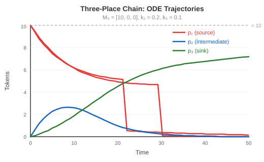

# From Discrete to Continuous

**Learning objective**: Convert a Petri net into an ODE system and understand why this is powerful.

The previous chapter gave you a toolkit for analyzing Petri nets: incidence matrices, state equations, P-invariants. All of that works by tracking integer tokens through discrete firing events. This chapter shows what happens when you let go of the integers — when tokens become real-valued concentrations and transitions fire continuously at rates determined by the net's structure. The state equation becomes a differential equation, and the entire apparatus of calculus becomes available.

## Why Discrete Event Simulation Hits Walls

Discrete Petri net simulation is straightforward. Pick an enabled transition. Fire it. Update the marking. Repeat.

For small nets this works fine. But as systems grow, three problems compound:

**Event volume scales with population.** A hospital ER with 10 patients might generate 50 events (arrivals, triages, consultations, discharges). The same ER with 10,000 patients generates 500,000 events. Each event must be processed sequentially — check which transitions are enabled, choose one, fire it, update the marking, record the event. The cost scales linearly with the number of tokens moving through the system.

**State space explodes.** The reachability set $R(M_0)$ grows combinatorially with the number of tokens and places. A net with 10 places and 100 total tokens can have astronomical numbers of reachable markings. Enumerating them becomes infeasible long before the model is "large" by real-world standards.

**Individual identity is usually irrelevant.** Discrete simulation tracks which specific token moved where. But for capacity planning, bottleneck analysis, or throughput estimation, you don't care about Patient 47. You care about how many patients are waiting, on average, and how fast the queue drains. Tracking individuals is expensive bookkeeping for information you don't need.

The continuous approach addresses all three. Tokens become real numbers — concentrations, not counts. Transitions fire continuously at rates determined by the current state. The evolution of the system is described by a set of ordinary differential equations (ODEs), one per place, and the cost of solving them does not grow with the number of tokens the way event-by-event simulation does.

## Mass-Action Kinetics

The bridge from discrete to continuous comes from chemistry, where it's called **mass-action kinetics**: the rate of a reaction is proportional to the product of the concentrations of its reactants.

Consider a transition $t$ with rate constant $k$ and two input places $p_1$ and $p_2$:

```
[p1] --> t[k] --> [p3]
[p2] --/
```

In the discrete world, $t$ fires when both $p_1$ and $p_2$ have at least one token. In the continuous world, $t$ fires at a **rate** that depends on how many tokens are in its inputs:

$$v(t) = k \cdot M(p_1) \cdot M(p_2)$$

More tokens in the input places means a higher firing rate. Zero tokens in any input place means zero rate — the transition stalls. This is the continuous analog of the enabling condition: instead of a binary enabled/disabled, you get a smooth rate that goes to zero as inputs deplete.

### The General Rate Law

For a transition $t$ with rate constant $k(t)$ and input places $p_1, p_2, \ldots, p_r$, go-pflow's solver uses:

$$v(t, M) = k(t) \cdot \prod_{i=1}^{r} M(p_i)$$

Each input place enters the rate once, to the first power, whatever its arc weight. The weight $w_i$ appears only in the stoichiometry: while $t$ flows at rate $v$, it drains $p_i$ at $w_i \cdot v$ and fills each output place at that arc's weight times $v$. A transition that consumes two tokens of $A$ per firing empties $A$ twice as fast as one that consumes one, but its rate is still linear in $M(A)$. This is the law in go-pflow's [`solver/ode.go`](https://github.com/pflow-xyz/go-pflow/blob/main/solver/ode.go) (`buildVecODEFunction`), which also sets a transition's flux to zero whenever any of its input places is at or below zero.

Textbook chemical mass action differs on this point: it raises each concentration to its stoichiometric coefficient, $M(p_i)^{w_i}$, so a reaction $2A \to B$ is quadratic in $A$. go-pflow does not. The two agree when every input arc has weight 1 and diverge otherwise; "When the Relaxation Doesn't Apply" below returns to what that means when two engines are compared.

### Why This Works

Mass action is the natural rate law when transitions fire at random with probability proportional to the availability of inputs. If a transition needs one token from $p_1$ and one from $p_2$, and tokens are selected at random, the probability of a successful firing scales as $M(p_1) \times M(p_2)$.

Chemistry discovered this in the 19th century. The same logic applies to any system where events happen stochastically and depend on resource availability: customers joining queues, orders consuming inventory, players taking turns.

## The Continuous Relaxation

With mass-action rates defined, we can write the ODE system for any Petri net. Recall the incidence matrix $C$ from Chapter 2, where $C[i,j]$ is the net change in place $p_i$ when transition $t_j$ fires. Collect all transition rates into a vector:

$$v(M) = [v(t_1, M), v(t_2, M), \ldots, v(t_m, M)]^T$$

The **continuous state equation** is:

$$\frac{dM}{dt} = C \cdot v(M)$$

This says: the rate of change of the marking is the incidence matrix times the rate vector. Each place's token count changes by the weighted sum of all transition rates affecting it; the weights are the entries of $C$, which is where arc weights enter the continuous model. Tokens flow in from transitions that produce, and flow out to transitions that consume.

### Example: Three-Place Chain

The simplest non-trivial example:

```
[p1] -> t1[k1] -> [p2] -> t2[k2] -> [p3]
```

Incidence matrix and rate vector:

$$C = \begin{bmatrix} -1 & 0 \\ 1 & -1 \\ 0 & 1 \end{bmatrix}, \quad v(M) = \begin{bmatrix} k_1 \cdot M(p_1) \\ k_2 \cdot M(p_2) \end{bmatrix}$$

The ODE system:

$$\frac{dM(p_1)}{dt} = -k_1 \cdot M(p_1)$$

$$\frac{dM(p_2)}{dt} = k_1 \cdot M(p_1) - k_2 \cdot M(p_2)$$

$$\frac{dM(p_3)}{dt} = k_2 \cdot M(p_2)$$

Starting from $M_0 = [10, 0, 0]^T$ with $k_1 = 0.2$ and $k_2 = 0.1$:



Because the system is linear, it has a closed form, which we derived by hand rather than from a solver run:

$$M(p_1, t) = 10\, e^{-0.2t}, \qquad M(p_2, t) = \frac{10\, k_1}{k_2 - k_1}\left(e^{-k_1 t} - e^{-k_2 t}\right) = 20\left(e^{-0.1t} - e^{-0.2t}\right)$$

and $M(p_3, t) = 10 - M(p_1, t) - M(p_2, t)$. Tokens drain from $p_1$ exponentially; $p_2$ fills, peaks at $t = \ln(k_1/k_2)/(k_1 - k_2) = \ln 2 / 0.1 \approx 6.9$ with exactly 5 tokens, then drains into $p_3$, which approaches 10. The figure plots these formulas. go-pflow checks its own solver against the same kind of closed form: `TestConsistencyLinearChain` in [`stochastic/consistency_test.go`](https://github.com/pflow-xyz/go-pflow/blob/main/stochastic/consistency_test.go) runs a three-place chain (100 tokens, rates 1 and 0.5) and requires the ODE to stay within 0.1 token of $100e^{-t}$, $200(e^{-t/2} - e^{-t})$ and their complement.

The conservation law still holds — $M(p_1) + M(p_2) + M(p_3) = 10$ for all time — because $[1, 1, 1] \cdot C = [0, 0]$. Tokens aren't created or destroyed, just redistributed continuously.

### What Changes, What Stays

The continuous relaxation changes the execution model (real-valued tokens, rate-based firing) but preserves the structural properties:

- **Conservation laws** still hold. If $w^T \cdot C = \vec{0}$ in the discrete case, the same identity holds in the continuous case, and the weighted token sum is constant for all time.
- **The incidence matrix** is identical. The structure of the net doesn't change.
- **Boundedness** from P-invariants still applies.

What you gain is speed at scale. The cost of a solve depends on the number of places and transitions and on how quickly the rates make the marking change, not on how many tokens there are to move one at a time; for a linear net like the chain, multiplying the initial marking by 1,000 multiplies the solution by 1,000 without changing its time scales. And the solution gives you a smooth trajectory — the entire evolution of the system, not just a sequence of discrete snapshots.

What you lose is individual identity. Token 47 no longer exists. You have 4.3 tokens in $p_2$ — a concentration, an average, a continuous quantity. For capacity and throughput questions that is usually the trade-off you want; "When the Relaxation Doesn't Apply" below covers the cases where it is not.

## Numerical Integration

Most ODE systems can't be solved analytically. Even the three-place chain above has a closed-form solution only because it's linear. Add a synchronization transition (two inputs) and the system becomes nonlinear — the rate depends on the product of two state variables. Analytical solutions vanish.

Instead, we solve numerically: start at the initial marking, compute the derivatives, step forward in time, repeat.

### Euler's Method (and Why It's Not Enough)

The simplest numerical method is Euler's method:

$$M_{n+1} = M_n + h \cdot f(t_n, M_n)$$

Where $h$ is the timestep and $f(t, M) = C \cdot v(M)$ is the derivative function. Compute the slope, take a step in that direction.

Euler's method works but is inaccurate. Its global error is $O(h)$ — to halve the error, you must halve the timestep and double the work. For Petri net simulations with rates spanning several orders of magnitude, tiny timesteps are needed, making Euler impractically slow.

### Runge-Kutta Methods

The standard remedy is to evaluate the derivative at multiple points within each step and combine them for a better approximation. These are **Runge-Kutta methods**, and they're classified by their *order* — the power of $h$ in the error term.

A 4th-order method (RK4) has local error $O(h^5)$ per step and global error $O(h^4)$; a 5th-order method has local error $O(h^6)$. Higher order means fewer steps for the same accuracy.

### Tsit5: What go-pflow Uses

The default solver in go-pflow is **Tsit5** — a 5th-order Runge-Kutta method published by Charalampos Tsitouras in 2011 ([`solver/tsit5.go`](https://github.com/pflow-xyz/go-pflow/blob/main/solver/tsit5.go) carries the reference and the coefficients). go-pflow evaluates its seven stages every step to compute both a 5th-order solution and an embedded 4th-order one. The difference between them estimates the error.

This error estimate enables **adaptive timestep control**. In go-pflow's `Solve` ([`solver/ode.go`](https://github.com/pflow-xyz/go-pflow/blob/main/solver/ode.go)) each step goes like this:

1. Compute both the 5th-order and 4th-order solutions
2. Scale each place's error estimate by $\text{Abstol} + \text{Reltol} \cdot |M(p)|$ and take the largest: $\varepsilon = \max_p |M_5(p) - M_4(p)| \,/\, (\text{Abstol} + \text{Reltol} \cdot |M(p)|)$
3. If $\varepsilon \le 1$: accept the step and grow the next one by $0.9\,\varepsilon^{-1/6}$, at most fivefold and never past `Dtmax`
4. If $\varepsilon > 1$: reject the step and retry with a smaller one (a step already at `Dtmin` is accepted regardless)

The solver takes large steps where the solution is smooth and small steps where it changes rapidly. You specify the error tolerance, not the timestep, so one solver covers both a slow-draining reservoir and fast kinetics without hand-tuning the step.

In code, the three-place chain above:

```go
net, rates := petri.Build().
    Place("p1", 10).Place("p2", 0).Place("p3", 0).
    Transition("t1").Transition("t2").
    Arc("p1", "t1", 1).Arc("t1", "p2", 1).
    Arc("p2", "t2", 1).Arc("t2", "p3", 1).
    WithCustomRates(map[string]float64{"t1": 0.2, "t2": 0.1})

prob := solver.NewProblem(net, net.SetState(nil), [2]float64{0, 50}, rates)
sol := solver.Solve(prob, solver.Tsit5(), solver.DefaultOptions())

final := sol.GetFinalState()
// closed form at t = 50: p1 ≈ 0.0005, p2 ≈ 0.13, p3 ≈ 9.87
```

The builder calls are those in go-pflow's [`petri/builder.go`](https://github.com/pflow-xyz/go-pflow/blob/main/petri/builder.go), and `NewProblem` builds the mass-action derivative from the net's arcs. We have not re-run this snippet for the book; the comment gives the closed-form values at $t = 50$, which `DefaultOptions()` (relative tolerance $10^{-3}$) should reproduce to about that precision. The caller specifies the net, the rates and the time span; the solver chooses the steps.

### Other Solvers

go-pflow provides several Runge-Kutta methods for different use cases:

| Solver | Order | Use Case |
|--------|-------|----------|
| `Tsit5()` | 5(4) | Default — best balance of speed and accuracy |
| `RK45()` | 5(4) | Dormand-Prince — the classic MATLAB `ode45` |
| `BS32()` | 3(2) | Bogacki-Shampine — faster per step, less accurate |
| `RK4()` | 4 | Classic fixed-step — no adaptive control |
| `Euler()` | 1 | Forward Euler — educational only |

For most Petri net simulations, Tsit5 is the right choice. On a simple decay, go-pflow's `TestSolverMethodsProduceSimilarResults` ([`solver/solver_test.go`](https://github.com/pflow-xyz/go-pflow/blob/main/solver/solver_test.go)) requires Tsit5, RK45 and BS32 to agree within 5%. `RK4()` and `Euler()` carry no error estimator, so under adaptive options they run at a fixed step of `Dt`. The lower-order methods exist for comparison and for systems where function evaluations are extremely expensive.

### Solver Presets

Rather than manually tuning tolerances, go-pflow provides presets for common scenarios:

```go
solver.DefaultOptions()    // General purpose (Dt=0.01, Reltol=1e-3)
solver.FastOptions()       // Game AI, interactive (Dt=0.1, Reltol=1e-2)
solver.AccurateOptions()   // Research, publishing (Dt=0.001, Reltol=1e-6)
solver.JSParityOptions()   // Match pflow.xyz JS solver exactly
```

The `FastOptions` preset trades precision for speed, for game AI where you need many evaluations per second; its doc comment in `solver/ode.go` estimates a tenfold speedup, and `TestFastOptionsSpeed` checks only that it takes fewer steps than `AccurateOptions` on an SIR net. `AccurateOptions` tightens tolerances for publication-quality results. `ode.go` defines further presets (`StiffOptions`, `EpidemicOptions`, `WorkflowOptions` and others).

## Equilibrium Detection

Many systems settle into a steady state where nothing changes anymore. The ODE solver can detect this automatically.

**Equilibrium** means:

$$\frac{dM}{dt} = C \cdot v(M^*) = \vec{0}$$

All derivatives are zero. Tokens still exist, but the flow in equals the flow out at every place. The system has reached a balance.

For the three-place chain, equilibrium is $M^* = [0, 0, 10]^T$, all tokens in $p_3$. The trajectory approaches it as $t \to \infty$ without reaching it: under the product rate law neither input place empties exactly, but both rates decay toward zero. This is a **terminal equilibrium** — the system winds down to a stop.

Other nets reach **dynamic equilibrium** where transitions still fire but the marking doesn't change. A net with a cycle:

```
[p1] -> t1[k1] -> [p2] -> t2[k2] -> [p1]
```

reaches equilibrium when $k_1 \cdot M(p_1) = k_2 \cdot M(p_2)$ — the flow from $p_1$ to $p_2$ equals the flow back. The tokens are still moving, but the concentrations are stable.

### Why Equilibrium Matters

Equilibrium tells you the long-run behavior of the system:

**Capacity planning.** A hospital ER at equilibrium has stable queue lengths. Those lengths tell you whether you have enough doctors, whether patients wait too long, whether the system is overloaded.

**Bottleneck identification.** At equilibrium, tokens accumulate before the slowest transition. A place with a high equilibrium concentration is a bottleneck — work piles up there because the downstream transition can't keep up.

**Optimization.** The equilibrium value of an objective function (profit, throughput, win probability) tells you how good a configuration is. Change a rate constant, re-solve to equilibrium, compare.

### In Code

go-pflow can solve until equilibrium is detected, stopping early instead of integrating to an arbitrary end time:

```go
prob := solver.NewProblem(net, initialState, [2]float64{0, 1000}, rates)

sol, result := solver.SolveUntilEquilibrium(
    prob,
    solver.Tsit5(),
    solver.DefaultOptions(),
    solver.DefaultEquilibriumOptions(),
)

if result.Reached {
    fmt.Printf("Equilibrium at t=%.2f\n", result.Time)
    fmt.Printf("Final state: %v\n", result.State)
    fmt.Printf("Max rate of change: %e\n", result.MaxChange)
}
```

The equilibrium detector in [`solver/equilibrium.go`](https://github.com/pflow-xyz/go-pflow/blob/main/solver/equilibrium.go) checks the maximum absolute derivative across all places at regular intervals of accepted steps, once a minimum time has passed. When that maximum is below a tolerance (default $10^{-6}$) at several consecutive checks, the solver declares equilibrium and stops. Presets control the sensitivity:

```go
solver.DefaultEquilibriumOptions()  // Tolerance 1e-6, 5 consecutive checks, every 10 steps
solver.FastEquilibriumOptions()     // Tolerance 1e-4, 3 checks, every 5 steps
solver.StrictEquilibriumOptions()   // Tolerance 1e-9, 10 checks, every step
```

`TestSolveUntilEquilibrium` in `solver/solver_test.go` exercises this on a single decaying place and requires equilibrium to be declared before the end of the time span.

## When the Relaxation Doesn't Apply

Everything above rests on one assumption: that a transition's firing rate is a smooth function of the current marking. That assumption is false for four common modeling constructs.

**Read arcs, inhibitor arcs, reachable capacities, and guards all depend on a firing instant** — a specific moment where the marking is checked against a threshold. Mass action has no such moment. It treats every input as a continuous flow, all the time, so there is no point at which it can ask "is this inhibitor's threshold exceeded right now?" or "did this firing just hit the capacity bound?" go-pflow's `stochastic.Forecast`, the continuous engine in its `stochastic` package, calls `Model.Gating()` ([`metamodel/firing.go`](https://github.com/pflow-xyz/go-pflow/blob/main/metamodel/firing.go)) first. `Gating()` names these four, plus two rarer constructs (non-kinetic input arcs and fixed delays), and a capacity counts only if some transition can raise its place. When the list is not empty, `Forecast` refuses rather than guess ([`stochastic/stochastic.go`](https://github.com/pflow-xyz/go-pflow/blob/main/stochastic/stochastic.go)):

```go
result, err := stochastic.Forecast(model, marking, stochastic.Options{})
// Diverged: true
// Reason: this model constrains firing in ways a continuous solution cannot
// express... Use the discrete engine (Simulate).
```

The refusal is deliberate: the ODE has no instant at which to ask the question. A model with a capacity that the net's own transitions can actually reach needs the discrete engine, `stochastic.Simulate`, which fires one event at a time and can check the bound at the instant it matters. Chapter 5 shows both sides of this line. The go-pflow coffee shop net built there declares no capacities and no guards, so the relaxation applies to it; petri-pilot's coffee shop model, which declares shelf capacities that its restock transitions can reach, is the kind `Forecast` refuses. Chapter 5's "A Caveat About the ODE" works through the difference.

**Below the four gating constructs, a second and separate question is population size.** On an ungated net whose input arcs all have weight 1, the discrete engine's *average* over many runs follows the ODE: exactly when every transition has a single input (the chain), and approximately when a transition multiplies two inputs together, with the gap shrinking as the population grows. go-pflow's [`stochastic/consistency_test.go`](https://github.com/pflow-xyz/go-pflow/blob/main/stochastic/consistency_test.go) checks both: the linear chain against its closed form, and an SIR epidemic at 1,000 and 10,000 individuals, where the relative gap must fall below 2% and shrink with size. A thousand customers served one at a time behave like a smooth curve; the discreteness averages out. Three baristas and a milk supply that runs dry five orders into a rush are a different regime. There, the *variance* is the answer you're after — how often does the shop actually run dry, not what it does on average — and the ODE has no ran-dry event to count. The rule of thumb: large populations and you want the average, use the ODE; small counts and you want the distribution of outcomes, or "how often does X happen," run the discrete engine and look at the spread across realizations.

**An arc weight above 1 is not the same law, more or less precisely computed, in the two engines.** The ODE's mass-action rate multiplies the input place's concentration into the flux once per input arc, no matter the weight — a transition that consumes 20g of beans per firing still contributes $M(\text{beans})$ to the rate, not $M(\text{beans})^{20}$ or any combinatorial term in 20. The discrete engine's propensity, by contrast, uses the full combinatorial count, $k \cdot \prod_p \binom{M(p)}{w_p}$ — the number of distinct ways to draw 20 indistinguishable tokens from however many are on hand, which is the stochastic (Gillespie) form of chemical mass action (the package comment at the top of [`stochastic/stochastic.go`](https://github.com/pflow-xyz/go-pflow/blob/main/stochastic/stochastic.go) states both laws). The two conventions coincide exactly at weight 1, where there's only one way to draw one token, and diverge for any recipe that consumes more than a single unit of an ingredient per firing. Neither is wrong — "what does the concentration do on average" and "how many indistinguishable tokens can I draw" are different questions once more than one token is consumed per firing — but don't expect a weight-20 arc to produce quantitatively matching numbers from both engines, even on a net the ODE doesn't refuse. go-pflow pins this disagreement in a test: on the dimerisation $2A \to B$ with 200 tokens of $A$, `TestConsistencyPreconditionIsHonest` requires the discrete mean and the ODE to differ by more than one token.

**A third engine sits between the two.** The chemical Langevin equation — a stochastic differential equation built from the same propensities the discrete engine uses, but with continuous state — gives *intrinsic* firing noise: a variance band, cheap enough to sweep like the ODE because its cost does not grow with the population. go-pflow implements it as `stochastic.SimulateSDE` ([`stochastic/sde.go`](https://github.com/pflow-xyz/go-pflow/blob/main/stochastic/sde.go)), and like `Forecast` it refuses a gated net. That is a different thing from the volatility petri-pilot's older `petri_sde` tool ([`pkg/mcp/sde.go`](https://github.com/pflow-xyz/petri-pilot/blob/main/pkg/mcp/sde.go)) adds: that tool layers exogenous geometric Brownian motion onto user-chosen "volatile" places on top of the ODE — the right tool for a DeFi price feed or an external demand shock, but noise imposed from outside the model rather than noise the net's own structure produces. Use the SDE path when the population is too large for the discrete engine's per-firing cost to be worth paying, but small enough that the ODE's zero-variance answer would be misleading, and the model has no gating for the ODE to refuse over in the first place.

### Choosing an Engine

| Your model has... | Use |
|---|---|
| a read arc, inhibitor, reached capacity, or guard | the discrete engine (or the ODE, and read the refusal) |
| large populations, no gating, you want the average | the ODE |
| small counts, you want the distribution or "how often does X happen" | the discrete engine |
| any input arc with weight > 1 | expect the two engines to disagree quantitatively — decide which rate law your model actually means |
| exogenous continuous uncertainty (price, demand) on top of the ODE | the volatility layer, not the relaxation itself |
| intrinsic firing noise, cheap enough to sweep | the chemical Langevin SDE |

Discrete, stochastic and continuous engines answer three different questions about the same net, and a model that answers one honestly may have nothing to say about another.

## The Full Picture

The continuous relaxation transforms the Petri net from a discrete-event system into a dynamical system. The incidence matrix becomes the stoichiometry matrix. The firing rule becomes mass-action kinetics. The state equation becomes a differential equation.

The incidence matrix and every P-invariant carry over unchanged. Read arcs, inhibitors, reachable capacities and guards do not, which is why the engines above refuse nets that use them. Where it applies, the continuous form is much cheaper to simulate at large populations and opens the door to equilibrium analysis, sensitivity analysis, and gradient-based optimization.

The pattern for using continuous Petri nets is:

1. **Build the net** — places, transitions, arcs (same as discrete)
2. **Assign rates** — a rate constant $k$ for each transition
3. **Solve the ODE** — from initial marking to final time or equilibrium
4. **Read the results** — token trajectories, equilibrium values, conservation checks

The remaining chapters in this book use this pattern extensively. The coffee shop in Chapter 5 uses equilibrium analysis for capacity planning. The knapsack problem in Chapter 8 uses continuous relaxation to approximate discrete optimization. The enzyme kinetics in Chapter 9 recover classical biochemistry equations directly from the net's structure.

In each case the mathematics is $dM/dt = C \cdot v(M)$; what changes from chapter to chapter is the net and its rates.
