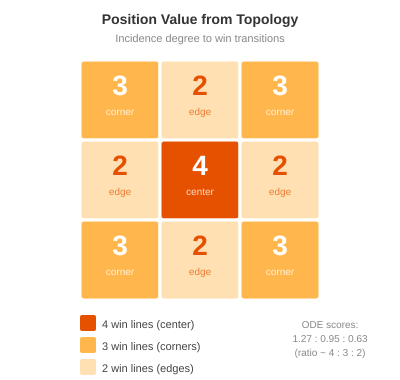

# Game Mechanics — Tic-Tac-Toe

**Learning objective**: Encode board positions, turns, and win conditions as token flow; use ODE simulation for move evaluation without game-specific heuristics.

The coffee shop modeled resources — fungible tokens flowing through recipes. This chapter models a game — structured tokens encoding board state, turn order, move history, and win detection. The Petri net is the same formalism, but the pattern is fundamentally different: a **GameNet** instead of a ResourceNet.

The claim this chapter tests is that strategic value can be read from model topology. We don't code "prefer the center." The Petri net's structure — which positions participate in more winning patterns — produces that preference through the ODE dynamics. Blocking is where the claim starts to fail, and the second half of the chapter is about that boundary and what closes it.

## The Board as Places

A tic-tac-toe board has nine cells. Each cell is a place, initialized with one token meaning "available":

```
P00: 1    P01: 1    P02: 1
P10: 1    P11: 1    P12: 1
P20: 1    P21: 1    P22: 1
```

The naming convention is `P{row}{col}`, zero-indexed. `P00` is the top-left corner, `P11` is the center, `P22` is the bottom-right corner.

When a player claims a cell, the token is consumed from the position place. An empty place ($M(P_{ij}) = 0$) means the cell is occupied. This is the enabling condition in action: a move transition for cell $(i,j)$ requires $M(P_{ij}) \geq 1$. Once the token is consumed, no other transition can claim that cell. The bipartite structure of the Petri net enforces the rule "you can't play in an occupied cell" without any conditional logic.

## Turn Control via Mutual Exclusion

Tic-tac-toe alternates between X and O. A single place `Next` controls whose turn it is:

- `Next = 0` means X's turn
- `Next = 1` means O's turn

Each X move transition produces a token into `Next`:

```
P_ij  -->  PlayX_ij  -->  X_ij
                      -->  Next
```

Each O move transition consumes a token from `Next`:

```
Next  -->  PlayO_ij  -->  O_ij
P_ij  -->
```

X goes first (Next starts at 0, so O transitions are blocked). After X plays, Next becomes 1, enabling O. After O plays, Next returns to 0. The alternation is structural — no turn counter, no modular arithmetic, just a token bouncing between "available" and "consumed."

This is the same mutual exclusion pattern from the traffic intersection in Chapter 1. The `Next` token is a shared resource that enforces sequential access, exactly like the shared token that prevents both lights from being green simultaneously.

## History Places for Pattern Detection

The basic model tracks where tokens are (board state) but not where they came from (move history). Adding history places upgrades the model from "what's on the board" to "who played where."

For each cell, two history places record which player claimed it:

```
X00, X01, X02, ..., X22    (9 places — X's moves)
O00, O01, O02, ..., O22    (9 places — O's moves)
```

When X plays at position (1,1):
- Consume token from `P11` (cell becomes occupied)
- Produce token in `X11` (record X played here)
- Produce token in `Next` (pass turn to O)

When O plays at position (0,2):
- Consume token from `Next` (it's O's turn)
- Consume token from `P02` (cell becomes occupied)
- Produce token in `O02` (record O played here)

The history layer doesn't change the game mechanics — it adds information without altering what moves are legal. But it enables win detection, which needs to know not just that a cell is occupied, but *which player* occupies it.

It also makes visible a split that every executing model in this book has, and that this net is small enough to show whole. The history places are **write-once**: no move transition takes a token back, and only the pattern collectors of the next section consume one. They are the model's *past* — monotone, irreversible, accumulating facts that a pattern collector can AND together without ever replaying the moves. The board places and `Next` are the *present*: the marking the next step is about. The move transitions and their enabling conditions are the *future*: recomputed from the marking on every step, stored nowhere. The past is tropical, the future is predicate, and the marking is where they meet. Appendix E states this once, formally; here it is just three groups of places and transitions, all in the same document.

### The Full Place Set

The complete model has 30 places:

| Category | Places | Count |
|----------|--------|-------|
| Board positions | P00–P22 | 9 |
| X history | X00–X22 | 9 |
| O history | O00–O22 | 9 |
| Turn control | Next | 1 |
| Win detection | WinX, WinO | 2 |

And a conservation constraint ties them together:

$$\sum_{i,j} M(P_{ij}) + \sum_{i,j} M(X_{ij}) + \sum_{i,j} M(O_{ij}) = 9$$

Every cell is in exactly one state: available ($P_{ij} = 1$), claimed by X ($X_{ij} = 1$), or claimed by O ($O_{ij} = 1$). The total is always 9 — the board size. This is a P-invariant of the move layer, and you can check it by hand from the incidence matrix: every move column takes one token from a $P$ place and puts one in an $X$ or $O$ place, so the weighted sum is unchanged. go-pflow's example declares it as the `board_size` constraint in [`examples/tictactoe/metamodel/tictactoe.go`](https://github.com/pflow-xyz/go-pflow/blob/main/examples/tictactoe/metamodel/tictactoe.go), which is also where the struct and flows below come from. The pattern collectors of the next section deliberately break it, since a collector consumes history tokens without returning them. That breakage is the point made there.

### In the DSL

Using the struct tag syntax from Chapter 4:

```go
type TicTacToe struct {
    _ struct{} `meta:"name:tic-tac-toe,version:v1.0.0"`

    // Board positions (1 = available)
    P00 dsl.TokenState `meta:"initial:1"`
    P01 dsl.TokenState `meta:"initial:1"`
    // ... P02 through P22

    // X move history (0 = not played)
    X00 dsl.TokenState `meta:"initial:0"`
    X01 dsl.TokenState `meta:"initial:0"`
    // ... X02 through X22

    // O move history
    O00 dsl.TokenState `meta:"initial:0"`
    // ... O01 through O22

    // Turn control and win detection
    Next dsl.TokenState `meta:"initial:0"`
    WinX dsl.TokenState `meta:"initial:0"`
    WinO dsl.TokenState `meta:"initial:0"`

    // Move actions (18 total: 9 for X, 9 for O)
    PlayX00 dsl.Action `meta:""`
    PlayO00 dsl.Action `meta:""`
    // ...

    // Win detection (16 total: 8 for X, 8 for O)
    XRow0 dsl.Action `meta:""`  // X00, X01, X02
    XDg0  dsl.Action `meta:""`  // X00, X11, X22
    // ...
}
```

The flows define the arc structure:

```go
func (TicTacToe) Flows() []dsl.Flow {
    return []dsl.Flow{
        // X moves: Position -> PlayX -> History + Next
        {From: "P00", To: "PlayX00"},
        {From: "PlayX00", To: "X00"},
        {From: "PlayX00", To: "Next"},

        // O moves: Next + Position -> PlayO -> History
        {From: "Next", To: "PlayO00"},
        {From: "P00", To: "PlayO00"},
        {From: "PlayO00", To: "O00"},

        // Win detection: 3-in-a-row -> WinX
        {From: "X00", To: "XRow0"},
        {From: "X01", To: "XRow0"},
        {From: "X02", To: "XRow0"},
        {From: "XRow0", To: "WinX"},
        // ... all 8 patterns for each player
    }
}
```

The total model: 30 places, 34 transitions, 118 arcs (27 for X's moves, 27 for O's, 64 for the sixteen collectors; the example's README prints the same counts when it loads the net). Every rule of tic-tac-toe — valid moves, turn alternation, win conditions — encoded purely in arc structure.

## Win Detection Without Search

Win detection is where the model becomes compositionally interesting. There are 8 winning patterns in tic-tac-toe: 3 rows, 3 columns, 2 diagonals. Each pattern is a transition that consumes three history tokens and produces a win token.

For the top row (X wins):

```
X00 --> XRow0 --> WinX
X01 -->
X02 -->
```

The transition `XRow0` is enabled when $M(X_{00}) \geq 1$ AND $M(X_{01}) \geq 1$ AND $M(X_{02}) \geq 1$ — all three top-row cells claimed by X. When it fires, it produces a token in `WinX`.

This is a **pattern collector**: a transition that recognizes a specific configuration of history tokens. Each winning pattern gets its own collector. No conditional logic, no "check all rows and columns" procedure — just 8 independent transitions, each watching for its specific three-token combination.

The 16 pattern collectors (8 for X, 8 for O) are the complete game-over detection system. When any one fires, the game has been won. Multiple can potentially fire (if a player completes two lines simultaneously), but in practice the first one to fire determines the winner.

### Why Composition Matters

Each pattern collector is independent. Adding a new win condition (say, for a variant game) means adding a new transition with three input arcs and one output arc. Removing a condition means removing a transition. The rest of the model is untouched.

The collectors are also the first place this book's core–observer split shows up. Every collector consumes three history tokens (four, once the halting fix below adds the turn token) and produces one, so its compression ratio $\rho$ — tokens consumed over tokens produced — is at least 3. The move transitions sit near $\rho = 1$: in this chapter's `Next`-as-a-bit encoding an X move consumes one token and produces two, an O move the reverse, and the pair of them is balanced; the symmetric two-turn-place encoding used on the blog makes each move exactly $\rho = 1$. That gap — balanced moves, compressing collectors — is what the tropical and zero-knowledge chapters detect as "observer". The collectors break nothing categorical: they are ordinary transitions with ordinary arcs, and they compose exactly as this section says. What they break is the one-producer-one-consumer property that the throughput analysis of Chapter 13 needs, and the uniformity of the circuit in Chapter 12. [Appendix E](appendix-e-categorical-foundations.md#where-the-free-structure-stops-two-boundaries) separates that boundary from the other one — guards — which is categorical and which tic-tac-toe does not have.

This is the compositional advantage of Petri nets over procedural game logic. In code, win detection is typically a function that iterates over patterns:

```go
winPatterns := [][]string{
    {"00", "01", "02"}, {"10", "11", "12"}, ...
}
for _, pattern := range winPatterns {
    if allMarked(pattern) { return true }
}
```

The procedural version works, but it's monolithic — changing the win conditions means changing the function. The Petri net version is modular — each pattern is an independent structural element that composes with the rest.

### Position Value from Topology

Each board position participates in a different number of winning patterns:

| Position | Patterns | Type |
|----------|----------|------|
| Center (1,1) | 4 | Row + Column + 2 Diagonals |
| Corners (0,0), (0,2), (2,0), (2,2) | 3 | Row + Column + 1 Diagonal |
| Edges (0,1), (1,0), (1,2), (2,1) | 2 | Row + Column |



The center participates in 4 winning patterns. Corners participate in 3. Edges participate in 2. This structural fact — encoded in the arc connectivity — is the source of strategic value. More connections to pattern collectors means more paths to victory, which the ODE dynamics translate into higher scores.

No game theory is needed to derive this. It falls directly from the net's topology.

## ODE-Guided Strategy

With the model defined, we can use the continuous relaxation to evaluate moves. The algorithm is simple:

1. For each available move, create a hypothetical state after making that move
2. Run the ODE simulation forward from that state
3. Read the final values of `WinX` and `WinO`
4. Score = my_win - opponent_win

The move with the highest score is the best move.

### The Scoring Function

Condensed from `ODEAIMove` in go-pflow's [`examples/tictactoe/cmd/game.go`](https://github.com/pflow-xyz/go-pflow/blob/main/examples/tictactoe/cmd/game.go), which runs it on the 30-place net with every rate set to 1.0:

```go
targetPlace := "win_x"
oppPlace := "win_o"
if currentTurn == PlayerO {
    targetPlace = "win_o"
    oppPlace = "win_x"
}

for _, move := range availableMoves {
    // Create hypothetical state
    hypState := copyState(currentState)
    hypState[position] -= 1
    hypState[historyPlace] += 1

    // Run ODE
    prob := solver.NewProblem(net, hypState,
        [2]float64{0, 3.0}, rates)
    sol := solver.Solve(prob, solver.Tsit5(), opts)
    final := sol.GetFinalState()

    // Score
    score := final[targetPlace] - final[oppPlace]
}
```

The mass-action ODE advances every enabled move at once instead of choosing one. When X has tokens in positions that participate in many patterns, the flow toward `WinX` is higher. When O can block a pattern, that flow is diverted. The final values of `WinX` and `WinO` aggregate that relaxed flow; they are not an average over discrete games, and how far apart the two are is what the tournament below measures.

### What the ODE Discovers

**Empty board evaluation.** X evaluates all 9 positions. On the 30-place net above, go-pflow's example prints these scores in the verbose output recorded in its [README](https://github.com/pflow-xyz/go-pflow/blob/main/examples/tictactoe/README.md) (not re-run for this edition):

- Center (1,1): score 0.487 — highest, because 4 pattern connections create the most flow toward WinX
- Corners: score 0.359 — second, 3 patterns each
- Edges: score 0.248 — lowest, 2 patterns each

The figure above and the tic-tac-toe blog post quote 1.27 / 0.95 / 0.63 for the same three cells. Those come from an earlier version of the net, and the ranking is the same.

The ODE has "discovered" the opening strategy: play the center. No minimax tree, no alpha-beta pruning, no opening book — just mass-action kinetics flowing through the net's topology.

**Responding to center.** After X takes center, O evaluates defensive options. All scores are negative (X has the advantage), but corners (-1.04) minimize X's lead better than edges (-1.38). The ODE discovers the defensive principle: play corners against center.

**Finding winning threats.** When X has center and a corner, the ODE identifies the opposite corner as the best move (score 1.39) because it creates a two-way threat — a fork that completes one diagonal while opening another. The pattern collectors naturally amplify fork positions because they have higher connectivity.

**Blocking.** When X has two in a row, O's best move is the blocking position (score 0.80 vs. 0.74-0.77 for other moves). The ODE discovers blocking because the flow toward WinX is dramatically higher along the threatened pattern. Placing a token to block cuts off that flow. Note how thin the margin is: a forced block wins by hundredths where the opening preferences differ by tenths. Tactical necessities are second-order effects in the relaxed flow — a weakness the tournament results below make concrete.

These four sets of numbers do not come from one net. The center-response and fork scores come from the same earlier version as 1.27 / 0.95 / 0.63; their magnitudes exceed 1, which a net that halts on a win cannot produce. The blocking scores, positive for O, come from the halting, draw-detecting net of the next section, in a test in a private repository. None was re-run for this edition. The rankings within each example are what we expect to carry between versions, and that has not been checked.

### Performance

Each move evaluation requires one ODE solve. With 9 possible moves on an empty board, that's 9 solves. Using tuned solver options:

```go
opts := &solver.Options{
    Dt:     0.2,
    Reltol: 1e-3,
}
```

The example's README reports about 0.04 seconds per move evaluation and about 1.8 seconds for a full ODE-vs-ODE game, which is 45 evaluations (9 + 8 + … + 1). We have not re-timed it. That is fast enough for interactive play.

How well does this evaluator actually play? Measuring that fairly requires two refinements the model does not yet have — the game must stop when someone wins, and a draw must be worth something to the defender. Both come next; the tournament follows them.

## Game Halting and Draw Detection

What happens when a player wins? In the basic model, tokens continue flowing after a win — the ODE doesn't know the game should stop. This distorts strategic values because the simulation averages over impossible continuations.

The fix is **game halting**: win transitions consume the turn token without returning it.

```
X00 --> XRow0 --> WinX
X01 -->
X02 -->
Next -->             (consume turn -- game stops)
```

When X wins, the `XRow0` transition consumes `Next` (it was O's turn). No turn token is returned. All further move transitions are blocked because they require either an empty position token or a turn token, and the turn token is gone. The win state becomes an **absorbing state** — once reached, no further flow is possible.

### Draw Detection

Draw detection adds a move counter. Each play transition deposits a token into `move_tokens`. A `draw` transition fires when:
- 9 move tokens have accumulated (all squares filled)
- `game_active` is still marked (no winner)

The draw transition deposits into its own `draw` place, and the scoring objective counts it for the defender: `win_x - win_o - draw`, which X maximizes and O minimizes. This encodes the principle that "a draw is a win for the defender" — tic-tac-toe is asymmetric, O cannot force a win, so O's goal is "X does not win" and a draw counts fully. (Keeping the draw in its own place, rather than crediting `WinO` directly, also keeps the outcome announceable: an application reading the marking can tell a draw from a win.)

That is the discrete reading. In the ODE the weight-9 arc does not make the draw a count to nine. go-pflow's flux is the rate times each input place's marking to the first power — here $M(\texttt{move\_tokens}) \cdot M(\texttt{game\_active})$ ([`solver/ode.go`](https://github.com/pflow-xyz/go-pflow/blob/main/solver/ode.go)) — and the weight scales only how much is consumed. So the relaxed draw starts firing from the first fractional move, as a hazard linear in `move_tokens`. Even so, adding it changes the ODE dynamics:

**Without draw detection:** O's scores are always negative. The model only sees win paths, so it favors positions with more winning lines even when blocking is essential.

**With draw detection:** O's scores become positive because draws count as partial victories. Blocking a threat now has measurable value — it preserves the possibility of a draw, which has positive worth.

### Tournament Results

With halting and draw detection in place, the complete model can play. The scoring function from earlier now reads the declared objective — `score = win_x - win_o - draw`, negated for O — and the tournament is reproducible: 100 games per matchup, the random player seeded, ODE ties broken by declared move order. The harness is [`examples/ch06-ttt-tournament/main.go`](https://github.com/pflow-xyz/book-pflow-xyz/blob/main/examples/ch06-ttt-tournament/main.go), pinned to go-pflow v0.23.1, and prints this table plus an ODE-vs-ODE game trace. The figures below are from its last recorded run; we did not re-run it for this edition.

Its net is the halting, draw-detecting construction, with three differences from the diagrams above. Two turn places, `x_turn` and `o_turn`, replace `Next`. A `game_active` token is spent by every detector and by the draw. And each detector reads its three history places catalytically, consuming and returning them, so a detected line stays on the board and the board-size sum survives the detectors. A catalytic detector consumes five tokens and produces four, so its $\rho$ is $5/4$ rather than the 4 of the halting diagram: still above 1, still on the observer side.

| Matchup | X Wins | O Wins | Draws |
|---------|--------|--------|-------|
| ODE vs Random | ~97% | 0% | ~3% |
| Random vs ODE | ~3% | ~88% | ~9% |
| ODE vs ODE | **100%** | 0% | 0% |

The ODE evaluator dominates random play from either side. As O — the seat that only exists to deny X — it converts ~88% of games into wins against a random X, which the draw-blind scorer could never do: without the draw term, blocking has no measurable value.

The third row looks wrong and is the most instructive number in the table. Two identical players, and X wins *every* game — where a naive reading expects all draws. But "same player both sides means a tie" is a property of **perfect** players only. Two copies of an imperfect evaluator lose in whichever seat their shared weakness is punished, and tic-tac-toe's seats are not symmetric: X's job is threat *creation*, a strategic property the aggregate flow measures well, while O's job is threat *denial* — exact, discrete, forced. So the same evaluator that goes ~88% as O against random play fumbles reliably against the one opponent that punishes a single missed block every time: itself. (Measured on the draw-blind model — `score = win_x - win_o`, a tie worth zero to both sides instead of counting against X — and with unseeded tie-breaking, this matchup comes out mostly drawn. That is an artifact of the scorer, not a property of the evaluator. The move *sequences* still vary slightly between runs, because the solver's floating-point summation order follows map iteration and flips near-ties; the harness's own comment says the outcome does not.) A representative game:

```
ply 1: X takes center        ply 2: O takes corner (2,0)
ply 3: X takes corner (0,0)  ply 4: O blocks the diagonal at (2,2)
ply 5: X takes edge (2,1), threatening column 1
ply 6: O plays (0,2) — the losing move
ply 7: X completes column 1 at (0,1)
```

At ply 6 the block at (0,1) is forced: X holds (1,1) and (2,1), so every other reply lets X complete column 1. Exact minimax over the same net agrees — `o_play_01` values at +1 for O (the draw) and every other move at -1 (X wins). The relaxation's own numbers at that position show why it fails: the forced block scores 0.248 while two strategically-pretty but losing corner moves score 0.275. The harness prints the trace, not these per-move values, so they are recorded here from a probe of that position and cannot be regenerated from the harness as shipped. A block's value is conditional on the opponent's *next discrete move*; in the continuous flow that conditionality is a second-order effect, and 0.027 of aggregate connectivity outweighs it. The forced block is exactly the thin-margin tactical judgment flagged earlier, and the margin goes the wrong way.

That exhibit is configuration-dependent in a way the failure class itself is not. This harness runs its win detectors fast (rate 720 against the plays' rate 1), so the referee dominates the relaxed flow; at uniform rates the same evaluator finds this particular block, and the margin flips back the right way. A tactic whose correctness depends on a solver rate choice was never being *seen* — it was balanced on an artifact, in whichever direction the rates happened to lean. What did not flip at any horizon, detector rate, or draw rate in a later sweep is the **double-corner fork**: X in opposite corners, O in the center, no threat on the board yet, where every corner reply loses and every edge draws. There the losing moves outscore the optimal ones on every final-state coordinate under every configuration tried (27, by the count at the time; the sweep code has since been pruned, so that count cannot be re-checked) — the fork is the relaxation's true boundary, and the missed block above is its rate-sensitive shadow.

That is the boundary of the relaxation used *alone*. It is a **strategic prior** derived from topology — it finds the center opening, the corner defense, forks, and most blocks, with no game knowledge anywhere — but a tactical necessity is a second-order effect in the relaxed flow, and it will occasionally miss one. The right place for a prior is not the driver's seat. Where its right seat is — and what it does there — closes this chapter, once the integer reduction has given the prior its closed form.

## The Integer Reduction

The ODE scores from the empty board are suspiciously proportional. Divide each by the smallest — the public example's and the earlier net's:

$$0.487 : 0.359 : 0.248 \approx 1.96 : 1.45 : 1 \qquad 1.27 : 0.95 : 0.63 \approx 2.02 : 1.51 : 1$$

Both are close to $4 : 3 : 2 = 2 : 1.5 : 1$. The ODE is tracking three integers — not computing them exactly, since the ratios are off by a few percent, but recovering the ranking and grouping that the integers predict.

### Incidence Degree to Terminals

The win transitions in this model are **terminal** — they are sinks in the net. The number of arcs from a position's history place to downstream win transitions is its **incidence degree**. This is a graph property — count the arcs, get an integer. No simulation needed.

| Position | Win patterns | Incidence degree |
|----------|-------------|-----------------|
| Center (1,1) | Row + Column + 2 Diagonals | 4 |
| Corners (0,0), (0,2), (2,0), (2,2) | Row + Column + 1 Diagonal | 3 |
| Edges (0,1), (1,0), (1,2), (2,1) | Row + Column | 2 |

The full board heatmap is `[3, 2, 3, 2, 4, 2, 3, 2, 3]`. The strategic value of a position in a game with terminal win states is determined by its incidence degree to those terminals. The ODE recovers this ranking through dynamics; the graph gives it directly.

### Generalizing to Any Board Size

The incidence degree formula works for any $n \times n$ board. Each position at $(i, j)$ gets:

- 2 (its row + its column), always
- +1 if on the main diagonal ($i = j$)
- +1 if on the anti-diagonal ($i + j = n - 1$)

So the only possible degrees are {4, 3, 2}, and degree 4 only occurs at the center of odd-sized boards. go-pflow's `TestIntegerReduction`, in [`examples/tictactoe/cmd/nxn_bench_test.go`](https://github.com/pflow-xyz/go-pflow/blob/main/examples/tictactoe/cmd/nxn_bench_test.go), builds the N×N game net for N = 3 to 7, checks each history place's arc count against that formula, and scores every opening move by the uniform-rate ODE from t = 0 to 9. It asserts two properties at every size:

- Positions with the same incidence degree score within 5% of each other
- A higher incidence degree scores higher

It prints, but does not assert, each degree's score as a ratio to the degree-2 score. As recorded in the blog post *The Incidence Reduction* (not re-run here), the error against the integer ratio is −2.0% (degree 4) and −3.6% (degree 3) at 3×3, −19.2% and −14.7% at 5×5, and −13.3% and −9.7% at 7×7. Our explanation for the drift is that more positions compete for flow through shared win transitions, since each win transition consumes every history place on its line at once. The ranking — which is what move selection needs — held at every size tested, so on the empty board the ODE's opening move is the arc-counting opening move.

### Dynamic Evaluation: Injecting Current State

The empty board is the easy case. The real utility comes from injecting the current game state as the marking and recomputing.

When a position is occupied, its token has been consumed — it drops out of the calculation. The incidence degree is now computed only against still-reachable win transitions. A corner that participates in 3 win patterns on an empty board might participate in only 1 if the opponent has blocked the other two. The heatmap updates to reflect the live topology.

This is the general "next step" evaluator. Given any board state:

1. Identify which win transitions are still reachable (not blocked by opponent pieces)
2. For each empty position, count the number of reachable win transitions it connects to
3. The highest count is the strategically strongest move — which, as the tournament showed, is not always the right move when a forced tactic is on the board

go-pflow's example does not package this counting procedure; what it runs is the ODE version, re-scoring every legal move each turn. sim.pflow.xyz's `sim_evaluate` tool has the closed form as its `incidence` method.

### The Boundary Between Counting and Simulation

Tic-tac-toe reduces to `{4, 3, 2}` precisely because it is simple enough that topology is all you need. The win transitions are independent sinks. No position participates in resource competition with another. The incidence structure has no interesting dynamics — just a direct count.

For more complex games — poker with its multi-phase betting structure, or governance models with competing resource flows — the incidence structure is rich enough that positions do not reduce to small integers. Multiple paths interact, resource constraints create bottlenecks, and the dynamics through the net have real work to do. The ODE earns its keep in those cases.

But the mechanism is identical:

1. Model the system as a Petri net with terminal (win/loss/goal) transitions
2. Inject the current state as the marking
3. Compute the evaluation from token flow to reachable terminals

For simple nets, step 3 is integer counting. For complex nets, step 3 is ODE simulation. The boundary between them is the boundary between systems where topology alone determines strategy and systems where dynamics matter.

What we have is a **static evaluation function defined purely by net topology and current state**. No heuristics, no training data, no game-specific knowledge beyond the Petri net model itself. For any game or system modeled as a Petri net with designated terminal states, the function is: *for each position, how connected is it to winning?* The Petri net is the domain knowledge — the topology encodes the rules, and the incidence structure encodes the strategic prior.

## Oracle Play

The tournament showed where the static evaluator's honesty runs out: it is a strategic prior, and a prior that drives loses to a forced block. This section puts it in its right seat. The result is perfect play, and — this is the point — perfect play *derived from the net*, with no more game knowledge than the evaluator itself used.

### The Search Is Already in the Net

Exact minimax needs four things: the legal moves, whose turn it is, when the game is over, and what the outcome was. The net declares all four. Legal moves are **enabled transitions** — an occupied cell's move is not pruned by game logic, it is simply not enabled, because the position token is gone. The turn is whichever turn place holds a token. The win detectors and the draw call are **the referee**: fired to quiescence between moves, they decide the game exactly as they did during simulation. And a missing turn token — absorbed by a detector — *is* the game-over test. The search over those semantics is a page of code with nothing about tic-tac-toe in it. Condensed from `minimax` in the tournament harness:

```go
func minimax(mk Marking, alpha, beta int) int {
    mk = fireHouse(mk)              // detectors and the draw call referee
    switch {
    case mk["x_turn"] > 0:
        // maximize over enabled x_play_* moves, prior-ordered
    case mk["o_turn"] > 0:
        // minimize over enabled o_play_* moves, prior-ordered
    default:                        // turn token absorbed: game over
        return mk["win_x"] - mk["win_o"]   // win +1, loss -1, draw 0
    }
}
```

Change the net — a 4x4 board, a misère rule where completing a line loses, an extra win pattern — and this player changes with it, because it was never written, only derived. The rules live in one artifact and everything else is a view of it.

### The Prior Takes Its Seat

The static evaluator's role changes from *player* to **oracle**: its ranking decides which move the search examines first, and never what any position is worth. That division of labor is exactly what alpha-beta wants — cutoffs come from trying strong moves early, so an ordering heuristic pays in pruned subtrees while remaining unable to corrupt the answer. And the integer reduction is what makes the oracle cheap: the ranking is the incidence degree, readable off the graph, with the ODE solve needed only where topology alone stops being enough.

The prior's value is measurable, not rhetorical: from the empty board, the harness reports that the exact search expands 18,297 positions taking moves in declared order, and roughly 7,000 with the prior ordering them — the same proven answer at about 2.6x less work (the precise count varies by a few percent run to run, because near-tied prior scores resolve by floating-point summation order). Trying center before edge is most of what there is to know about tic-tac-toe move ordering, and the prior knows it from the arc structure alone.

### Perfect Play, Measured

The same tournament harness, with the oracle seated:

| Matchup | X Wins | O Wins | Draws |
|---------|--------|--------|-------|
| Oracle vs Oracle | 0% | 0% | **100%** |
| ODE vs Oracle | 0% | 0% | **100%** |
| Oracle vs ODE | ~40% | 0% | ~60% |

Every game between two oracles is a draw — the "identical players tie" intuition holds the moment both players are actually perfect, and the search proves the game's value from the empty board is the draw. The oracle never loses from either seat: as O it blocks every threat the bare relaxation missed, and as X it converts the heuristic's missed blocks into wins about 40% of the time while conceding nothing. This construction — a topological prior ordering an exact search over the same net — is what a deployed bot should ship. sim.pflow.xyz's `sim_evaluate` tool ships it as its `search` method: alpha-beta minimax over the declared game, with a transposition table and the incidence ranking from the integer reduction ordering the moves ([Chapter 18: sim.pflow.xyz — From Description to Checked Model](ch18-code-generation.md)).

### The Objective Is a Modelling Statement

One detail in the harness deserves its own paragraph, because it is a lesson about declaring objectives rather than about search. The oracle's leaves score win +1, loss -1, draw 0 — the three outcomes must rank for perfect play to mean anything. The model's *declared* objective, `win_x - win_o - draw`, instead folds the draw into the defender's win. That is the right encoding for the asymmetric question it was written to ask — O cannot force a win, so O's goal is "X does not win," and a draw counts fully for O. But it makes X indifferent between drawing and losing. An earlier version of the harness, whose oracle X maximized the declared objective, lost 59% of its games against itself, every loss a position it valued identically to the draw it could have had; that version is not the one in the repository, which scores leaves win +1, loss −1, draw 0. Same net, same search, one term moved in the objective — and "perfect play" quietly meant something else. An objective is a modelling statement, and this is what getting one wrong looks like from the inside.

## Declaring the Opponent

Oracle play answers the question this chapter set out with, through a division of labor: structure for the prior, search for the tactics. That division turns out not to be forced, and the reason is a lesson about modelling.

The starting point is the fork boundary above, sharpened into an impossibility: at the double-corner trap, the losing corner replies *dominate* the optimal edges on every coordinate of the relaxed final state — lower opponent-win mass, higher own-win mass, higher draw mass — at every rate configuration tried. So no monotone scoring function over that final state, one that never prefers less of O's good outcomes or more of X's, can pick the right move. Whatever fixes the fork must change the net being evaluated, not the number read off it.

That reframes what the evaluator was doing all along. Mass-action flow with uniform rates advances every legal continuation in proportion to availability alone, which reads as a mean-field version of *both players moving at random*. On that reading the ceiling the experiment measured for play-scoring — every game drawn as X against a minimax opponent, 93 of 100 drawn as O — is what to expect: the evaluator catches every tactic visible as a static threat and fails where the value lives in the opponent's *forced* replies. (We have not compared it against a random-playout evaluator directly.) What the relaxation lacks is an opponent model, and an opponent model is declarable.

The declaration is direct. For each win line and each of its cells, add a copy of that cell's play transition, catalyzed — read arcs, nothing moved — by the opponent holding the line's other two cells. Forty-eight transitions, one shared rate. Inside the forward solve, wherever a threat exists, flow pours into the move that answers it: the simulated players stop being random and start playing *threats-are-answered*. The evaluation net is then **derived** from the declared one by mechanical transforms — delete the draw machinery (its counting semantics cannot survive the relaxation, and keeping it measurably poisons the objective), delete the places that become write-only, add the forced-reply copies — leaving two scalars, the reply bias and the defender's win-versus-survive exchange rate, both of which fall out of a two-parameter fit against minimax labels from a naive start.

The verdict is stronger than any tournament: a referee walks *every* legal opponent line, both seats, and checks that the evaluator's move never worsens the position's exact game value. Over all distinct reachable decisions — 96 as X, 309 as O — it found **zero value-losing moves and zero missed wins**. One ODE solve per candidate, a linear read of the final state, no search — and it never loses a drawn position and converts every won one, against arbitrary opposition. The experiment, its fifteen findings, and the exhaustive referee live in `experiments/ode-minimax` in sim.pflow.xyz's source, which is not public; the derivation transforms and the fitting ship as general tools in go-pflow's `derive` and `learn` packages (v0.23.1). (The experiment runs on sim.pflow.xyz's shipped tic-tac-toe model. It has the harness's catalytic detectors and weight-9 draw counter, but its draw deposits into `win_o` instead of a place of its own, and the experiment measures against a minimax opponent rather than a random one, so its numbers are not this chapter's tables. The structural conclusions carry.)

Two of those findings deserve restating here because they are about modelling, not tic-tac-toe. First, **static evaluators degrade gracefully with initiative and sharply without it**: a tempo ahead, every threat you must answer is already on the board — a fact the flow measures directly, which is why the bare relaxation was already perfect as X — while a tempo behind, the decisive danger is assembled from the opponent's forced replies and lives only in move order. When testing an evaluator on any game, instrument the defending seats first. Second, **a prior the structure already computes must not be written in again**: the integer reduction earlier in this chapter showed the topology producing the 4:3:2 incidence ranking for free, and every attempt to *also* encode those counts — into deposit weights, into detector rates, in any direction — measurably degraded play. The topology applies its prior exactly once, and every duplicate is paid for.

Where does that leave oracle play? Intact, and honestly priced. The search is still the cheapest *guarantee* — a page of derived code whose answer is proven, with the prior pruning its tree. What the derived evaluator adds is the demonstration that the guarantee was never the relaxation's ceiling: hand the flow a net that declares how opponents actually behave, and the flow alone reaches the same perfection. The declared model stays the single source of truth and the referee. The evaluation net is what it was all along — a *compiled artifact*, built from the declaration by transforms with stated semantics, and the compiler is where the modelling lives.

## The GameNet Pattern

Tic-tac-toe demonstrates the GameNet pattern from Chapter 4:

1. **Board state as places** — each cell is a place, tokens mark availability
2. **Move history as places** — separate tracking of who played where
3. **Turn control as a shared token** — mutual exclusion enforces alternation
4. **Pattern collectors as transitions** — compositional win detection
5. **ODE scoring** — strategic value emerges from topology
6. **Integer reduction** — for simple games, the ODE collapses to incidence degree counting
7. **Oracle play** — the prior orders an exact search over the same net; perfect play is derived, not programmed
8. **Derived evaluation nets** — declare the opponent's policy as structure (forced-reply transitions) and the relaxation alone reaches the same perfection, no search at all

The same pattern scales to more complex games. A Connect Four model would have 42 position places (7 columns × 6 rows) and more pattern collectors (horizontal, vertical, diagonal sequences of 4). A Go model would have 361 position places. The complexity is in the number of places and patterns, not in the logic. When the game is simple enough, the strategic prior is a set of integers you can read off the graph without running the solver at all; whether the prior is enough to play well is the question the tournament, oracle and derived-net sections answer for this game, and it has to be asked again for each new one.

The mathematical foundation is the coffee shop's. The incidence matrix encodes all arcs, P-invariants say which weighted token sums are conserved (here, the board-size sum of the move layer), and the ODE gives the relaxed flow. The difference is interpretation: in the coffee shop, tokens are grams of beans; in tic-tac-toe, tokens are board positions and move records.

> **Try it live:** The [Tic-Tac-Toe model](https://sim.pflow.xyz/whatif/?id=5a08c67862a2eb55799f5229) is in sim.pflow.xyz's catalog, where the `sim_evaluate` MCP tool scores a player's legal moves from any position — by seeded rollouts by default, or with the `search` and `incidence` methods described above (Chapter 18).

The next chapter applies Petri nets to constraint satisfaction — modeling Sudoku as a system where arc weights and conservation laws enforce the puzzle's rules, and the ODE relaxation finds valid configurations. Chapter 13 returns to the integer reduction from a different angle: deriving rate constants automatically from graph connectivity, and feeding them directly into the ZK verification pipeline.
