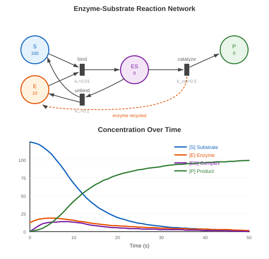

# Biochemistry — Enzyme Kinetics

**Learning objective**: See how Petri nets naturally model chemical reactions, recovering classical equations.

The previous chapters applied the continuous semantics of [Chapter 3: From Discrete to Continuous](ch03-discrete-to-continuous.md) to domains that borrowed it — resource flows, games, puzzles, optimization. This chapter returns to the domain that rate law came from: chemistry. Enzyme kinetics is the study of how enzymes catalyze reactions, and the Michaelis-Menten equation is its central rate law.

Textbooks start from four rate equations, assume the enzyme-substrate complex sits at a quasi-steady state, and do the algebra. A 4-place Petri net with mass-action rates gives you those four rate equations without anyone typing them, and the solver integrates them as they stand, with no steady-state assumption. Michaelis-Menten is still an approximation of that system, and it still comes from the algebra; what the net changes is that the system being approximated is the model itself rather than a hand transcription of it.

## Substrate, Enzyme, Product

An enzyme catalyzes the conversion of substrate to product in three steps:

$$E + S \rightleftharpoons ES \rightarrow E + P$$

1. **Binding**: enzyme and substrate combine to form a complex (rate $k_1$)
2. **Unbinding**: the complex falls apart without producing product (rate $k_{-1}$)
3. **Catalysis**: the complex converts substrate to product, releasing the enzyme (rate $k_{cat}$)

The enzyme is not consumed; it cycles between free and bound states, and that cycle maps directly onto token flow.

## The Petri Net

Four places, three transitions:

| Place | Initial | Role |
|-------|---------|------|
| `substrate` | 100 | Free substrate molecules |
| `enzyme` | 10 | Free enzyme molecules |
| `complex` | 0 | Enzyme-substrate complex |
| `product` | 0 | Converted product |

| Transition | Rate | Arcs |
|------------|------|------|
| `bind` | $k_1 = 0.01$ | substrate + enzyme → complex |
| `unbind` | $k_{-1} = 0.1$ | complex → substrate + enzyme |
| `catalyze` | $k_{cat} = 0.5$ | complex → product + enzyme |



The arc structure encodes the chemistry directly. `bind` consumes a free enzyme, and both `unbind` and `catalyze` give one back. The enzyme is not an input of `catalyze`; it is a catalyst because every path out of `complex` returns it.

The net is declared as `services/enzyme-kinetics.json` in sim.pflow.xyz's source (a private repository): the four places and three rates above, and nine arcs, all of weight 1.

### In Code

The same net in go-pflow's builder API ([`petri/builder.go`](https://github.com/pflow-xyz/go-pflow/blob/main/petri/builder.go)). There is no enzyme example in go-pflow's `examples/`, so this snippet is not a file in the repository and has not been run:

```go
net, rates := petri.Build().
    Place("substrate", 100).
    Place("enzyme", 10).
    Place("complex", 0).
    Place("product", 0).
    Transition("bind").
    Transition("unbind").
    Transition("catalyze").
    Arc("substrate", "bind", 1).
    Arc("enzyme", "bind", 1).
    Arc("bind", "complex", 1).
    Arc("complex", "unbind", 1).
    Arc("unbind", "substrate", 1).
    Arc("unbind", "enzyme", 1).
    Arc("complex", "catalyze", 1).
    Arc("catalyze", "product", 1).
    Arc("catalyze", "enzyme", 1).
    WithCustomRates(map[string]float64{
        "bind":     0.01,
        "unbind":   0.1,
        "catalyze": 0.5,
    })
```

`WithCustomRates` returns the net and the rate map together; `WithRates` takes a single default rate for every transition, which is not what this model needs.

## Mass-Action Kinetics as Native Semantics

With mass-action kinetics, each transition fires at a rate proportional to the product of its input concentrations:

$$v(\text{bind}) = k_1 \cdot [S] \cdot [E]$$
$$v(\text{unbind}) = k_{-1} \cdot [ES]$$
$$v(\text{catalyze}) = k_{cat} \cdot [ES]$$

Every input arc here has weight 1, so go-pflow's first-power rate law and textbook chemical mass action coincide for this net (Chapter 3 explains where they differ). The ODE system follows from the topology as $dM/dt = C \cdot v(M)$, with $C$ the incidence matrix (rows are places, columns are transitions) and $v(M)$ the vector of the three rates:

$$\frac{d[S]}{dt} = -k_1 \cdot [S] \cdot [E] + k_{-1} \cdot [ES]$$

$$\frac{d[E]}{dt} = -k_1 \cdot [S] \cdot [E] + k_{-1} \cdot [ES] + k_{cat} \cdot [ES]$$

$$\frac{d[ES]}{dt} = k_1 \cdot [S] \cdot [E] - k_{-1} \cdot [ES] - k_{cat} \cdot [ES]$$

$$\frac{d[P]}{dt} = k_{cat} \cdot [ES]$$

Nobody writes these equations into the simulation. go-pflow's solver builds each derivative from the arcs ([`solver/ode.go`](https://github.com/pflow-xyz/go-pflow/blob/main/solver/ode.go): flux is the rate times the product of the input markings), as Chapter 3 describes. The service definition does carry the four equations as metadata, for people to read; the solver never sees them.

## Michaelis-Menten as an Approximation

Set $d[ES]/dt \approx 0$ (the quasi-steady-state assumption):

$$k_1 \cdot [S] \cdot [E] = (k_{-1} + k_{cat}) \cdot [ES]$$

Solving for the reaction rate $v = k_{cat} \cdot [ES]$ and using $[E]_{total} = [E] + [ES]$:

$$v = \frac{V_{max} \cdot [S]}{K_m + [S]}$$

where $K_m = (k_{-1} + k_{cat}) / k_1$ and $V_{max} = k_{cat} \cdot [E]_{total}$.

This is the **Michaelis-Menten equation**, and it comes from the algebra, not from the solver. The solver integrates the full four-equation system; Michaelis-Menten approximates it well when $[E]_{total}$ is small against $[S] + K_m$ (at the defaults below, 10 against 160).

The saturation curve itself, rate against initial substrate, would come from a sweep: integrate the net across a range of initial substrate, take the initial rate at each, and plot it against $V_{max} [S] / (K_m + [S])$. The expectation is a close match at $[E]_{total} = 10$ and a drift as $[E]_{total}$ approaches $[S] + K_m$. No code in the pflow repositories runs that sweep yet, so this is a prediction, not a result.

### The Saturation Effect

Why does the rate saturate? The Petri net makes it visible through token flow.

At low substrate, most enzyme tokens are in the `enzyme` place (free). Increasing [S] means more `bind` events, so the rate climbs linearly. But at high substrate, almost all enzyme tokens are tied up in `complex`. Adding more substrate can't speed things up — there's no free enzyme to bind with.

$K_m$ is the substrate concentration at half-maximum rate. With the default parameters, $K_m = (0.1 + 0.5) / 0.01 = 60$. It is often read as binding affinity, but that reading holds only when $k_{cat} \ll k_{-1}$. Here $k_{cat}$ is five times $k_{-1}$, and the dissociation constant $k_{-1} / k_1$ is 10, so most of $K_m = 60$ is turnover rather than loose binding.

$V_{max}$ is the rate with all enzyme bound. With 10 enzyme molecules and $k_{cat} = 0.5$, $V_{max} = 0.5 \times 10 = 5.0$.

Both values are the two formulas above applied to the rate constants. Neither is fitted to a simulated curve.

### Simulation Readouts

A browser demo built from the same net and default rates (now retired) integrated it with Tsit5 at a fixed step $dt = 0.05$ over a 30-second window and reported four readouts. Its source is `frontends/enzyme-kinetics/main.js` in petri-pilot (`runODE` and `computePredictions`):

| Readout | Default Value | What It Is |
|------------|---------------|---------------|
| Time to 50% conversion | ~17s | First time free substrate falls to half its initial value |
| Peak reaction rate | ~2.95 | Largest finite-difference d[P]/dt in the run |
| Final yield | ~70% | Product as a percentage of initial substrate at the end of the window |
| $K_m$ / $V_{max}$ | 60 / 5.0 | Computed from the rate constants, not measured from the run |

The first three come out of the integration. They are the demo's readouts at the default settings and have not been re-run for this edition.

One of them can be checked by hand. Since $d[P]/dt = k_{cat} [ES]$ and $[ES]$ can never exceed the 10 enzyme molecules, the peak rate is bounded by $V_{max} = 5$. The Michaelis-Menten approximation gives a closer estimate: at $[S] = 100$ it predicts $5 \times 100 / 160 \approx 3.1$, and free substrate only falls from there. A peak of about 2.95 sits just under that estimate, as expected when some substrate is already tied up in complex by the time the rate peaks. That is a derivation, not a run.

The concentration curves show the familiar pattern: substrate depletes as product accumulates, with the enzyme-substrate complex rising quickly and then falling as substrate runs out.

## Conservation Laws from P-Invariants

The net's structure carries two conservation laws.

**Enzyme conservation:**

$$[E] + [ES] = [E]_{total} = 10$$

Free enzyme plus bound enzyme always equals the initial enzyme count. Nothing in the model states this as a constraint; it follows from the arcs. The enzyme circulates through `enzyme → complex → enzyme` but never leaves the system.

Check via P-invariant: the weight vector $w = [0, 1, 1, 0]$ (for places [substrate, enzyme, complex, product]) satisfies $w^T \cdot C = \vec{0}$:

- `bind` column: $0(-1) + 1(-1) + 1(+1) + 0(0) = 0$
- `unbind` column: $0(+1) + 1(+1) + 1(-1) + 0(0) = 0$
- `catalyze` column: $0(0) + 1(+1) + 1(-1) + 0(+1) = 0$

**Mass conservation:**

$$[S] + [ES] + [P] = [S]_{initial} = 100$$

Substrate is either free, bound in complex, or converted to product. The weight vector is $w = [1, 0, 1, 1]$:

- `bind` column: $1(-1) + 0(-1) + 1(+1) + 1(0) = 0$
- `unbind` column: $1(+1) + 0(+1) + 1(-1) + 1(0) = 0$
- `catalyze` column: $1(0) + 0(+1) + 1(-1) + 1(+1) = 0$

Both checks are by hand, against the nine arcs of the service definition. Because $w^T C = 0$, the exact ODE gives $d(w^T M)/dt = w^T C \, v(M) = 0$, so both sums are constant along every trajectory. The demo did not check them during a run. They make a useful test: if $w^T M$ drifts in a simulation, an arc is missing, a weight is wrong, or the solver has a bug. go-pflow's solver tests make that check for small nets (`TestSolveConservation` in [`solver/solver_test.go`](https://github.com/pflow-xyz/go-pflow/blob/main/solver/solver_test.go)), not for this one.

## Parameter Exploration and Sensitivity

Changing the rate constants explores the model. The values below follow from the formulas; none of these scenarios has been re-run for this edition.

**High enzyme, low substrate** ($E_0=50, S_0=20$): there is plenty of enzyme, so the reaction runs much faster. This is also where the Michaelis-Menten constants stop meaning much. With 50 enzyme against $S_0 + K_m = 80$, the quasi-steady-state condition fails, and the formula's $V_{max} = 25$ is unreachable: by the second conservation law, the complex can hold at most the 20 substrate molecules there are, so $d[P]/dt$ never exceeds $0.5 \times 20 = 10$.

**Low $k_1$** ($k_1=0.001$): binding becomes the bottleneck. $K_m = (0.1 + 0.5)/0.001 = 600$, six times the default initial substrate.

**High $k_{cat}$** ($k_{cat}=2.0$): the enzyme turns over faster and $V_{max}$ rises to 20, but $K_m$ also rises, to $(0.1 + 2.0)/0.01 = 210$. Faster catalysis empties the complex faster, so more substrate is needed to keep it populated.

**Equal $k_{-1}$ and $k_{cat}$** ($k_{-1}=0.5, k_{cat}=0.5$): a complex is equally likely to unbind or to catalyze, so half the binding events are "wasted" on unbinding. $K_m = (0.5 + 0.5)/0.01 = 100$, higher than the default.

Each scenario is a different set of rate constants on the same net; the structure does not change. This is the pattern throughout the book: one model, many scenarios.

## Beyond Chemistry

The shape — a limited resource cycling between free and occupied, with throughput capped by how much of it there is — resembles processes and cores, callers and agents, jobs and machines. None of those has been built as a net here, and the mapping is looser than swapping labels. A call center has no obvious `unbind` (a caller abandoning mid-service, perhaps), and a context switch is overhead on the core rather than a reversible binding. What should carry over is the enzyme invariant, free plus busy is constant, and the ceiling that comes with it: throughput cannot exceed rate × servers, for the same reason $d[P]/dt$ cannot exceed $k_{cat} \cdot [E]_{total}$.

The enzyme net is a ComputationNet in the sense of [Chapter 4: The Token Language](ch04-token-language.md): continuous quantities, rate-based firing, and conservation laws carried by the arcs. It is small enough to understand completely. What it establishes is that the net generates the mass-action ODE system without anyone writing it and carries two conservation laws in its structure; the Michaelis-Menten equation is the quasi-steady-state reduction of that system.
